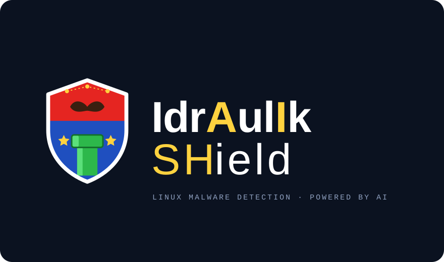

<p align="center">
  
</p>

# Idraulik Shield

*Linux malware detection · powered by AI*

Idraulik Shield is a plug-and-play daemon for Debian-based Linux servers. Once installed it watches the
whole machine (open ports, Wi-Fi, Bluetooth, local network, critical files, services and logs) with
lightweight monitors, writes alerts to a log file, and uses AI agents to triage them. By default it runs
on a local [Ollama](https://ollama.com) model; optionally you can plug in Claude, Gemini, GitHub Models,
OpenAI or any OpenAI-compatible API just by adding an API key. Write actions are queued for human
approval by default.

> **Status: proof of concept.** This is an early experiment, only lightly tested and not ready for
> production. It is not a replacement for a real antivirus/IDS. The project would like to grow: if you
> are interested in Linux security, local AI or sysadmin automation and want to help develop it, you are
> very welcome. Open an issue or a pull request, or get in touch.

## Install (Debian/Ubuntu)
```
sudo ./install.sh --with-ollama     # omit the flag to use only remote providers
```
Installs to `/opt/idraulik`, config in `/etc/idraulik/`, systemd unit `idraulik`.

## Structure
| Path | Purpose |
|---|---|
| `src/idraulik/providers.py` | Ollama, Anthropic, Gemini, OpenAI-compatible clients |
| `src/idraulik/monitors.py` | Baseline/diff monitors: ports, wifi, lan, bluetooth, files |
| `src/idraulik/alerts.py` | Alert log writer/reader |
| `src/idraulik/tools.py` | System tools, `risk=read` or `risk=write` |
| `src/idraulik/agent.py` | Tool-calling loop, fallback providers, approval policy |
| `src/idraulik/daemon.py` | Periodic checks, reports in `/var/lib/idraulik/reports.jsonl` |
| `src/idraulik/approvals.py` | Queue for write actions |
| `skills/*.md` | Skills (prompt playbooks) copied to `/etc/idraulik/skills`; add your own |
| `config/idraulik.toml` | Providers, interval, policy |
| `config/secrets.env.example` | API tokens (`/etc/idraulik/secrets.env`, mode 600) |

## Usage
```
idraulik check                 # one health check now
idraulik ask "why is nginx down?"
idraulik reports -n 3
idraulik approvals list|approve <id>|reject <id>
idraulik tools | idraulik skills
```

## Alerts and monitors
Deterministic monitors (no AI cost) run every 60s and diff against a baseline (`/var/lib/idraulik/baseline.json`,
first run only records it). Alerts go to `/var/log/idraulik/alerts.log`:
```
2026-10-15T14:42:00 WARN [ports] new EXPOSED listener tcp 0.0.0.0:4444 (process: nc)
```
| Monitor | Detects |
|---|---|
| `ports` | every listening TCP/UDP port: new/closed listeners, process changes, exposure on all interfaces |
| `wifi` | new APs, evil-twin BSSIDs for known SSIDs, open networks, connection changes (NetworkManager) |
| `lan` | new devices (MAC) on the local network |
| `bluetooth` | new nearby devices, new paired devices = CRIT (bluez) |
| `files` | sha256/mode/owner changes on critical files (`/etc/passwd`, `/etc/ssh`, sudoers, authorized_keys...); add paths via `extra_watch_paths` |

Monitors needing missing hardware/tools (no wifi/bluetooth adapter) are skipped silently.
Every 15 min the local AI triages the alerts and, if it concludes WARN/CRIT, adds an `[ai]` alert.
`idraulik alerts --level WARN`, `idraulik monitor --reset` (new baseline).

## Adding remote AI (optional)
Local Ollama is the default. Put a key in `/etc/idraulik/secrets.env` and restart; the provider becomes an
automatic fallback if Ollama fails:

| Provider | Key |
|---|---|
| Claude | `ANTHROPIC_API_KEY` |
| Gemini | `GEMINI_API_KEY` |
| GitHub Models | `GITHUB_TOKEN` |
| OpenAI / OpenRouter | `OPENAI_API_KEY` / `OPENROUTER_API_KEY` |

Any other OpenAI-compatible endpoint: add a `[providers.x]` block with `type = "openai"`. `idraulik providers` lists the chain.
Cursor has no public LLM inference API, so it cannot be used as a provider.

## Safety model
- Read tools run freely; `restart_service` / `run_command` need approval (`policy.approval = "required"`).
- `run_command` has a built-in denylist (rm -rf /, mkfs, reboot...) applied even in `auto` mode. No shell is used.
- Note: remote providers receive system data (logs, process names). Use local models for sensitive hosts.

## Dev
```
pip install -e . pytest && pytest
IDRAULIK_CONFIG=config/idraulik.toml idraulik tools
```
